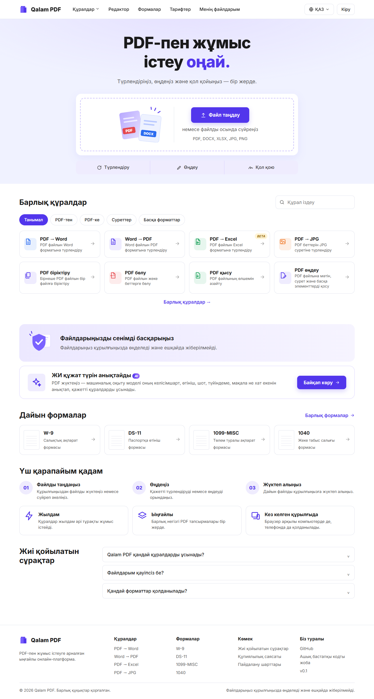
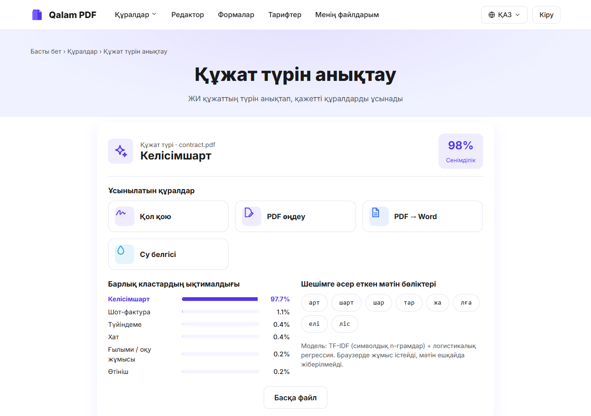
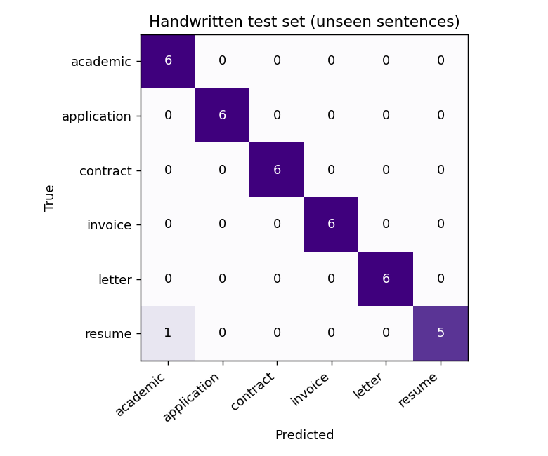

# Qalam PDF · v0.1

**PDF-пен жұмыс істеуге арналған қазақ тіліндегі тегін веб-сервис.** Түрлендіру, өңдеу, қол қою, дайын формалар және **құжат түрін анықтайтын ЖИ моделі**. Барлық өңдеу браузердің ішінде жүреді, файлдар ешқайда жіберілмейді.

- 🌐 Демо: **https://rusyeat.github.io/convieterdocument/**
- 📊 ЖИ моделінің есебі: [`ml/results/report.md`](ml/results/report.md)
- 🤖 ЖИ құралдарын қолдану декларациясы: [`AI_USAGE.md`](AI_USAGE.md)
- Курс: **ICT 1103 Information and Communication Technologies** (QAIRU, 2026–2027), MC2 топтық жобасы



---

## Мазмұны
1. [K1 · Мәселе, пайдаланушы және силлабуспен байланыс](#k1-мәселе-пайдаланушы-және-силлабуспен-байланыс)
2. [K2 · Деректер, дереккөздер және қауіпсіздік](#k2-деректер-дереккөздер-және-қауіпсіздік)
3. [K3 · Жұмыс істейтін прототип және әдісті негіздеу](#k3-жұмыс-істейтін-прототип-және-әдісті-негіздеу)
4. [K4 · Нәтижені тексеру, сапа және шектеулер](#k4-нәтижені-тексеру-сапа-және-шектеулер)
5. [K5 · Құжаттама және қайта іске қосу](#k5-құжаттама-және-қайта-іске-қосу)

---

## K1. Мәселе, пайдаланушы және силлабуспен байланыс

### Мәселе
Студенттер, жеке кәсіпкерлер, мемлекеттік қызметкерлер және жай азаматтар PDF құжаттармен күнделікті жұмыс істейді: келісімшартқа қол қою, өтініш толтыру, PDF-ті Word-қа айналдыру, файлды кішірейту. Бұл үшін қолданылатын онлайн-сервистердің үш кемшілігі бар:

| Кемшілік | Мысал | Неге маңызды |
|---|---|---|
| **Ақылы** | Танымал PDF-сервистердің бірі 7 күндік сынақ кезеңінен кейін 4 апта сайын **$39** алады, ал файлды жүктеп алу тек жазылғаннан кейін мүмкін | Студент пен шағын бизнес үшін қымбат |
| **Құпиялылық** | Файл шетелдік серверге жүктеледі | Келісімшарттарда, түйіндемелерде, шоттарда дербес деректер болады (ЖСН, мекенжай, банк деректемелері). ҚР Цифрлық кодексі (№ 255-VIII) мен ЖИ туралы заң (№ 230-VIII) дербес деректерді қорғауды талап етеді |
| **Тіл** | Интерфейстер көбіне ағылшын немесе орыс тілінде | Қазақ тілді пайдаланушыға ыңғайсыз |

### Шешім
Qalam PDF барлық құралды **браузердің ішінде** орындайды: файл құрылғыдан шықпайды, сервер жоқ, тіркелу де жоқ, бәрі тегін. Интерфейс 11 тілде, негізгі тілі қазақша. **ЖИ моделі** құжаттың түрін анықтап (келісімшарт, өтініш, шот, түйіндеме, ғылыми жұмыс, хат), сол құжатқа қажетті құралдарды ұсынады.

### Пайдаланушылар
- **Студент:** курстық жұмысты Word ↔ PDF түрлендіреді, файлдарды біріктіреді, өтінішке қол қояды.
- **Жеке кәсіпкер / шағын бизнес:** шот-фактураны Excel-ге айналдырады, келісімшартқа қол қояды, су белгісін қояды.
- **Азамат:** дайын форманы (өтініш, келісімшарт, W-9) толтырады, сканерленген құжаттан мәтін алады (OCR).

### Силлабуспен байланыс (ICT 1103)

| Апта | Силлабус тақырыбы | Жобадағы орны |
|---|---|---|
| **6** | Supervised learning; accuracy, precision, recall, F1; GridSearchCV | Құжат түрін анықтайтын модель: логистикалық регрессия, гиперпараметр `C` GridSearchCV арқылы таңдалған, метрикалар [`ml/results`](ml/results) |
| **7** | Мәтінді өңдеу және NLP: токенизация, TF-IDF, мәтінді жіктеу | Символдық n-грамдардағы TF-IDF + жіктеу ([`ml/train.py`](ml/train.py), [`js/classifier.js`](js/classifier.js)) |
| **8** | Компьютерлік көру | OCR құралы: Tesseract LSTM нейрондық желісі суреттен мәтін таниды |
| **5** | Киберқауіпсіздік, ҚР заңнамасы, цифрлық қолтаңба | Файлдар серверге жіберілмейді; дербес деректері жоқ синтетикалық датасет; PDF-ке қол қою |
| **3** | HCI, usability | 11 тіл, RTL (араб тілі), мобильді нұсқа, сүйреп әкелу (drag & drop) |
| **4** | Деректерді талдау және визуализация | Confusion matrix және модель сапасының графигі |
| **9–10** | MLOps, контейнерлеу, қайта іске қосу, цифрлық үкімет | `Dockerfile`, бекітілген seed мен нұсқалар, `requirements.txt`, автоматты тесттер, дайын формалар |

Курстың оқу нәтижелері: **CLO 5** (классификация әдісі және метриканы негіздеу), **CLO 6** (цифрлық сервис прототипі және құжаттама), **CLO 3** (деректерді қорғау).

---

## K2. Деректер, дереккөздер және қауіпсіздік

### ЖИ қай жерде қолданылады

| # | ЖИ / МО моделі | Не істейді | Файл |
|---|---|---|---|
| 1 | **Құжат түрін анықтау** — TF-IDF (символдық 2–4-грамдар) + **логистикалық регрессия** (scikit-learn, біз оқыттық) | PDF мәтінін 6 класқа жіктейді, сенімділікті және шешімге әсер еткен мәтін бөліктерін көрсетеді, қажетті құралдарды ұсынады | Оқыту: [`ml/train.py`](ml/train.py) · Салмақтар: [`assets/model/doc-classifier.json`](assets/model/doc-classifier.json) · Браузерде іске қосу: [`js/classifier.js`](js/classifier.js) · Интерфейс: `ai_classify` құралы, [`js/tools.js`](js/tools.js) |
| 2 | **OCR** — Tesseract.js 5.1.1, **LSTM нейрондық желісі** (алдын ала оқытылған, `kaz+rus+eng` тілдері) | Сканерленген PDF пен суреттен мәтін таниды, нәтижесін Word-қа сақтайды | [`js/tools.js`](js/tools.js), `RUN.ocr` функциясы |

Сайтта: басты беттегі **«ЖИ құжат түрін анықтайды»** баннері → `#/tool/ai_classify`, және «Барлық құралдар → Басқа форматтар» → **OCR**.



### Деректер мен дереккөздер

| Дерек | Көзі | Көлемі | Лицензия / ескерту |
|---|---|---|---|
| Оқыту жиыны [`ml/data/train.csv`](ml/data/train.csv) | Біз жасадық: [`ml/make_dataset.py`](ml/make_dataset.py), seed=42 | 1 080 мәтін (6 класс × 3 тіл × 60) | **Синтетикалық**: қолмен жазылған жалпы сөйлемдерден құралған, **дербес деректер жоқ** |
| Тест жиыны [`ml/data/test_handwritten.csv`](ml/data/test_handwritten.csv) | Қолмен жазылды, оқыту сөйлемдерін **қайталамайды** | 36 мәтін (6 класс × 3 тіл × 2) | Аты-жөндер ойдан алынған |
| W-9, 1099-MISC, 1040 формалары | irs.gov ресми бос PDF файлдары | 3 файл | АҚШ үкіметінің жұмысы, public domain |
| Noto Sans қарпі | Google Noto Fonts | 2 файл | SIL Open Font License 1.1 |
| OCR тіл модельдері (`kaz`, `rus`, `eng`) | tessdata, CDN арқылы жүктеледі | — | Apache 2.0 |

**Неліктен синтетикалық деректер:** нақты келісімшарттарда, түйіндемелерде және шоттарда ЖСН/БСН, мекенжай, банк деректемелері болады. Силлабус (7-бөлім, *Data security*) мен Бағалау ережелерінің 12.8-тармағы ондай деректерді ашық репозиторийге салуға тыйым салады. Сондықтан деректерді жалпы үлгі сөйлемдерден өзіміз құрастырдық. Бұл шешімнің бағасы [K4 шектеулері](#шектеулер) бөлімінде жазылған.

### Қауіпсіздік

| Қатер | Қорғаныс |
|---|---|
| Файлдың үшінші тарапқа ағып кетуі | Сервер жоқ. Өңдеудің бәрі браузердің JavaScript-інде (pdf.js, pdf-lib, модель) жүреді. Файл желіге шықпайды |
| Мәтінді ЖИ сервисіне жіберу | ЖИ моделі де браузерде орындалады. Мәтін сыртқы API-ге (OpenAI т.б.) **жіберілмейді** |
| «Менің файлдарым» бөлімінің сақталуы | Тек осы браузердің IndexedDB қоймасында сақталады. Пайдаланушы кез келген уақытта өшіре алады |
| Кіру формасы | v0.1-де аккаунт жоқ. Пошта мен құпиясөз **сақталмайды және жіберілмейді**, тек «жақында» деген хабар шығады |
| Бөгде кітапханалар (supply chain) | Кітапханалар cdnjs/jsDelivr-ден **нақты нұсқамен** алынады (мысалы `pdf.js/3.11.174`), `latest` қолданылмайды |
| XSS | Файл аттары мен мәтіндер `UI.esc()` арқылы экрандалады |
| Құпиясөзбен қорғалған PDF | Ашылмайды, пайдаланушыға түсінікті хабар шығады |

---

## K3. Жұмыс істейтін прототип және әдісті негіздеу

### Не жұмыс істейді (v0.1)
- **Түрлендіру:** PDF → Word, PDF → Excel (beta), PDF → JPG, PDF → PPT, Word → PDF, Excel → PDF, JPG → PDF
- **Беттер:** біріктіру, бөлу (әр бетті жеке немесе ауқым бойынша), қысу, бұру, беттерді жою
- **Өңдеу:** редактор (мәтін, сурет, қолтаңба салу/жазу, белгілеу, өшіру, беттерді бұру/жою, болдырмау/қайталау), су белгісі
- **ЖИ:** құжат түрін анықтау, OCR (beta)
- **Формалар:** W-9, 1099-MISC, 1040 және қазақша келісімшарт пен өтініш үлгілері (редакторда толтырылады), DS-11 ресми сайтқа сілтеме
- **Менің файлдарым:** нәтижелер браузерде сақталады, таңдаулылар, іздеу
- **11 тіл:** қазақ, орыс, ағылшын, неміс, француз, араб (RTL), қытай, корей, испан, итальян, дат
- **Дизайн:** берілген макет бойынша 9 экран, оның ішінде мобильді нұсқа

### Архитектура

```
Браузер (сервер жоқ)
 ├─ index.html + css/style.css            интерфейс (дизайн макеті бойынша)
 ├─ js/app.js        маршрутизатор, беттер (басты, құралдар, файлдар, тарифтер, модальдар)
 ├─ js/tools.js      17 құрал + ЖИ құралы: файл → өңдеу → нәтиже
 ├─ js/editor.js     PDF редакторы
 ├─ js/core.js       PDF операциялары (DOM-сыз, Node-та да тестіленеді)
 ├─ js/classifier.js ЖИ моделі: TF-IDF + логистикалық регрессия (inference)
 ├─ js/docx.js       .docx файлын жасау
 ├─ js/forms.js      формалар, қазақша үлгілерді генерациялау
 ├─ js/store.js      «Менің файлдарым» (IndexedDB)
 └─ js/i18n.js       11 тілдің аудармасы

Python (тек оқыту үшін, офлайн)
 ml/make_dataset.py → ml/data/train.csv
 ml/train.py        → assets/model/doc-classifier.json + ml/results/*
```

### Әдістерді негіздеу

| Шешім | Неге осылай | Балама және неге таңдалмады |
|---|---|---|
| **Барлығы браузерде** | Құпиялылық (K2), сервер шығыны жоқ, GitHub Pages-те тегін | Python/Node сервері: файлды серверге жіберу керек болады және ай сайын шығын |
| **pdf.js** (оқу/рендер), **pdf-lib** (жазу) | Mozilla мен ашық қауымдастықтың тұрақты кітапханалары, браузерде жұмыс істейді | Ghostscript/LibreOffice: тек серверде жұмыс істейді |
| **PDF → Word:** мәтін блоктарын координаталары бойынша жолдарға, ал жолдарды абзацтарға біріктіру. Тақырып қаріп өлшемінен, жуан қаріп қаріп атауынан анықталады | Нәтижесі **өңдеуге болатын** мәтін болады, сурет емес | Әр бетті сурет ретінде салу: мәтінді өңдеуге болмайды |
| **ЖИ: символдық n-грамдар (2–4)** | Қазақ тілі жалғамалы: «келісімшарт», «келісімшарттың», «келісімшартқа» бір сөздің түрлері. Символдық n-грамдар («келіс», «шарт») олардың бәріне ортақ, сондықтан модель лемматизаторсыз жалпылайды. Бір модель 3 тілде жұмыс істейді | Сөздік TF-IDF + Naive Bayes: салыстырдық, қолжазба тестте **83.3%**, ал біздің модель **97.2%** |
| **Логистикалық регрессия** | Шағын (JSON ~430 KB), браузерде бірден іске қосылады, ықтималдықтары калибрленген (сенімділік көрсетіледі, 0.45-тен төмен болса «сенімсіз» деп ескертеді), салмақтары арқылы шешімді түсіндіруге болады | BERT сияқты нейрондық желі: жүздеген MB, баяу, бұл міндет үшін артық |
| **`C` таңдауы log-loss бойынша** | Синтетикалық деректерде барлық `C` мәні F1=1.0 береді, сондықтан F1 бойынша таңдасақ ең әлсіз `C=0.3` таңдалып, сенімділік ~30%-ке түседі. Log-loss ықтималдықтардың сапасын бағалайды, сондықтан `C=100` таңдалды (медианалық сенімділік ~72%) | F1 бойынша таңдау (ең алдымен осылай істеп, кемшілігін байқадық) |
| **Tesseract LSTM (OCR)** | Қазақ тілінің (`kaz`) дайын моделі бар, WebAssembly арқылы браузерде жұмыс істейді | Бұлттағы OCR API: файлды жіберу керек болады (K2) |

---

## K4. Нәтижені тексеру, сапа және шектеулер

### Автоматты тесттер

| Жиын | Саны | Нәтиже | Не тексереді |
|---|---|---|---|
| Unit ([`tests/unit.test.js`](tests/unit.test.js)) | 18 | ✅ 18/18 | PDF операциялары, PDF→Word дәлдігі, PDF→Excel ұяшықтары, .docx құрылымы, 11 тілдің толықтығы, **ЖИ: sklearn-мен сәйкестік (parity)** |
| E2E ([`tests/e2e.test.js`](tests/e2e.test.js)), headless Chrome | 14 | ✅ 14/14 | Нақты сайтта: біріктіру, PDF↔Word, JPG, қысу, бет жою, **ЖИ құралы**, редактор (қазақша мәтін PDF-ке жазылады), формалар, араб тілі (RTL), мобильді нұсқа, JS қателерінің жоқтығы |

### Сапа метрикалары

**ЖИ моделі** (толық есеп: [`ml/results/report.md`](ml/results/report.md), сандар: [`ml/results/metrics.json`](ml/results/metrics.json)):

| Жиын | Модель | Accuracy | Precision | Recall | F1 (macro) |
|---|---|---|---|---|---|
| Валидация (синтетиканың 20%-ы, 216) | Char TF-IDF + LogReg | 1.000 | 1.000 | 1.000 | 1.000 |
| **Қолжазба тест (36, бұрын көрмеген сөйлемдер)** | **Char TF-IDF + LogReg** | **0.972** | **0.976** | **0.972** | **0.972** |
| Қолжазба тест | Word TF-IDF + Naive Bayes (baseline) | 0.833 | 0.861 | 0.833 | 0.833 |

Тіл бойынша (қолжазба тест): қазақ тілі **91.7%**, орыс тілі **100%**, ағылшын тілі **100%**.



**Сапаны түсіндіру:**
- Валидациядағы 100% нәтиже **асыра бағаланған**: валидация мен оқыту бір сөйлем жиынынан құралған. Сондықтан модельдің шынайы сапасының көрсеткіші **қолжазба тест**: ондағы сөйлемдер мүлде басқа (97.2%).
- Жалғыз қате: қазақша түйіндеме («Мен туралы: студентпін… Тағылымдама…») «ғылыми жұмыс» деп жіктелді. Себебі «студент», «практика», «деректерді талдау» сөздері оқыту деректерінде көбіне ғылыми жұмыстарда кездеседі.
- **Браузердегі модель Python-мен бірдей:** 36 мәтінде ықтималдықтардың ең үлкен айырмасы 7.8·10⁻⁶ (`AI: JS inference reproduces scikit-learn` тесті).

**Түрлендіргіштер:**
- PDF → Word: сынақ құжатында сөздердің дәлдігі **100%** (LCS бойынша), тақырып Heading 1 болып шығады, ал бірнеше жолға жалғасқан абзацтар бір абзацқа біріктіріледі.
- PDF → Excel: сынақ кестесінде **12/12** ұяшық дұрыс, сандар сан ретінде сақталады.
- Тесттер **екі нақты қатені** тауып, олар түзетілді: (1) қысқа абзацтардағы жол аралығы медиана арқылы қате есептелген еді, ол 25-перцентильге ауыстырылды; (2) pdf.js-тің бос орын элементтері кесте ұяшықтарын біріктіріп жіберетін.

### Шектеулер
1. **ЖИ:** оқыту деректері синтетикалық, ал тест жиыны шағын (36 мысал, 35-і дұрыс). 95%-дық сенімділік интервалы (Wilson) шамамен 86–99%. Тест мәтіндерін де ЖИ жазды ([AI_USAGE.md](AI_USAGE.md)), сондықтан ол толық тәуелсіз емес. Нақты құжаттарда сапа төмендеуі мүмкін. Модель 6 кластан басқа түрді тани алмайды: ондай кезде сенімділік төмен шығып, «сенімсіз» деген ескерту көрсетіледі.
2. **PDF → Word:** суреттер мен кестелер көшірілмейді, күрделі макет (бағандар) жеңілдетіледі.
3. **Word/Excel → PDF:** нәтиже беттің суреті ретінде шығады, сондықтан мәтінді таңдауға болмайды. Беттер бос жолдан бөлінеді.
4. **Қысу:** беттер JPEG-ке айналады, сондықтан мәтін іздеуге келмейді. Егер нәтиже түпнұсқадан үлкен болса, түпнұсқа қалдырылады.
5. **Редактор:** PDF-те бұрыннан бар мәтінді өзгерту мүмкін емес, тек үстіне жаңа мәтін қосылады немесе ескі мәтін «өшіру» құралымен жабылады. Бетті бұрғанда сол беттегі элементтер өшеді.
6. **OCR:** алғаш іске қосқанда тіл модельдері (~10–20 MB) жүктеледі, бір бетті тану бірнеше секундқа созылады.
7. **PPT → PDF** жоқ (браузерде сапалы жасау мүмкін емес). Аккаунттар мен төлем де жоқ.
8. Интернет қажет: кітапханалар CDN-нен жүктеледі.

---

## K5. Құжаттама және қайта іске қосу

### Сайтты іске қосу
```bash
git clone https://github.com/rusyeat/convieterdocument.git
cd convieterdocument
npm install          # тек тесттерге керек
npm start            # http://127.0.0.1:8080
```
Немесе Docker арқылы:
```bash
docker build -t qalam-pdf .
docker run -p 8080:80 qalam-pdf
```

### Тесттер
```bash
npm test             # 18 unit-тест (Node 20+)
npm run test:e2e     # 14 e2e тест (Chrome немесе Edge керек; басқа жол болса CHROME_PATH=...)
```

### ЖИ моделін қайта оқыту
```bash
# uv орнатылған болса (Python өзі жүктеледі):
uv run --python 3.12 --with-requirements ml/requirements.txt ml/make_dataset.py
uv run --python 3.12 --with-requirements ml/requirements.txt ml/train.py
# немесе: pip install -r ml/requirements.txt && python ml/make_dataset.py && python ml/train.py
npm test             # parity тесті браузердегі модельдің sklearn-мен бірдей екенін тексереді
```
Қайталанымдылық: `SEED = 42` (датасет, бөлу, CV, модель), нұсқалар [`ml/requirements.txt`](ml/requirements.txt) мен [`package.json`](package.json) файлдарында бекітілген, CDN кітапханалары да нақты нұсқамен алынады.

### Құрылым
```
index.html, css/, js/          сайт
assets/fonts, forms, model/    қаріптер, бос формалар, ЖИ моделі
ml/                            датасет, оқыту, нәтижелер
tests/                         unit, e2e, жергілікті сервер
docs/screens/                  скриншоттар
Dockerfile, AI_USAGE.md, LICENSE
```

### Лицензия
Код: MIT ([LICENSE](LICENSE)). Қаріптер: SIL OFL 1.1. IRS формалары: public domain.
